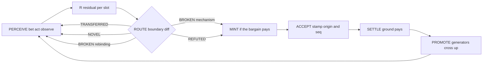

# Tether

A recursive, domain agnostic, self consistent metatheory that functions as a barrier theorem, with a CPU only recursive self improvement agent as its instantiation.

[](https://www.youtube.com/watch?v=bL5R7PhVCbM)

**[Watch Video](https://www.youtube.com/watch?v=bL5R7PhVCbM)**

[](https://doi.org/10.34740/KAGGLE/W/105084)
[](https://doi.org/10.5281/zenodo.24403207)

A CPU only agent that teaches itself. It is given no model of any world and no answers. It watches, predicts, acts, and keeps only the ideas the world pays for. The ideas it keeps are small programs in a typed language, so it builds its own vocabulary and then builds on it. Every step is written to a record that a separate checker can fail.

The agent is the instantiation, not the claim.

## Contents

- [Why this exists](#why-this-exists)
- [What recursive self improvement means here](#what-recursive-self-improvement-means-here)
- [Quickstart](#quickstart)
- [Architecture](#architecture)
- [The four branches](#the-four-branches)
- [What the agent can do](#what-the-agent-can-do)
- [Prior art and how this differs](#prior-art-and-how-this-differs)
- [How to cite](#how-to-cite)
- [FAQ](#faq)
- [Contributing](#contributing)
- [Community](#community)

<details>
<summary>Figure by figure index</summary>

The thirteen figures are the canonical statement of the theory. They live in the [`figures/`](https://github.com/IsaiahN/tether/tree/general-agent/figures) folder of this repository and in the Zenodo record.

1. [The Agent: how structure grows](https://github.com/IsaiahN/tether/blob/general-agent/figures/Figure_1_The_Agent_REV3.svg)
2. [The Ground and the Alignment Problem](https://github.com/IsaiahN/tether/blob/general-agent/figures/Figure_2_The_Ground_REV%20(1).svg)
3. [The Dependency Chain: status per link](https://github.com/IsaiahN/tether/blob/general-agent/figures/Figure_3_Dependency_Chain_REV.svg)
4. [The Membrane Between Scales](https://github.com/IsaiahN/tether/blob/general-agent/figures/Figure_4_The_Membrane.svg)
5. [The Mint Pipeline](https://github.com/IsaiahN/tether/blob/general-agent/figures/Figure_5_The_Mint_Pipeline_REV.svg)
6. [Closure and Reachability](https://github.com/IsaiahN/tether/blob/general-agent/figures/Figure_6_Closure_Reachability_REV.svg)
7. [The Room Chain](https://github.com/IsaiahN/tether/blob/general-agent/figures/Figure_7_The_Room_Chain_REV.svg)
8. [The Union Surplus](https://github.com/IsaiahN/tether/blob/general-agent/figures/Figure_8_The_Union_Surplus.svg)
9. [When Composition Stops Working](https://github.com/IsaiahN/tether/blob/general-agent/figures/Figure_9_Leave_Arrive_Search.svg)
10. [The Ground Maintainer](https://github.com/IsaiahN/tether/blob/general-agent/figures/Figure_10_The_Ground_Maintainer.svg)
11. [The Habitat](https://github.com/IsaiahN/tether/blob/general-agent/figures/Figure_11_The_Habitat.svg)
12. [The Bond](https://github.com/IsaiahN/tether/blob/general-agent/figures/Figure_12_The_Bond.svg)
13. [The Minimum Viable Set](https://github.com/IsaiahN/tether/blob/general-agent/figures/Figure_13_The_Minimum_Viable_Set.svg)
14. [Operators Table](https://github.com/IsaiahN/tether/blob/general-agent/figures/Figure%20-%20Operators%20Table.svg)
15. [Symbols Table](https://github.com/IsaiahN/tether/blob/general-agent/figures/Figure%20-%20Symbols%20Table.svg)

The formula is in [`figures/THE_FORMULA.md`](https://github.com/IsaiahN/tether/blob/general-agent/figures/THE_FORMULA.md).

</details>

## Why this exists

Most approaches to machine intelligence start from the same place: take everything humanity has written, compress it into weights, and hope that enough scale turns the trace into the thing that made it. It cannot. A sentence is what was left after a mind finished thinking. It is not the mind. Train on the residue and you get the residue back, fluent and ungrounded, needing constant correction to stay coherent. The generator never travelled with the output.

Recursive self improvement is usually pictured the same way, as a system that rewrites its own core faster each time. The ambition is total: not just a new rule here and there, but the ability to rewrite everything about its own source code, including the part that decides what to rewrite. That sounds like the strongest form of self improvement, and it is the goal most labs are quietly aiming at. It also sounds more like a virus than an autonomous agent. A thing that can change every line of itself, including the line that decides what to change, has no stable core of its own. It lives by borrowing the machinery of whatever it infects. It changes quickly, but it has no autonomy and no lineage, because there is nothing persistent for a lineage to carry.

The Tether starts from a different definition, closer to a seed. A seed keeps a fixed kernel and grows everything else. It becomes something in a particular ground, and what it learned there is carried forward by a lineage rather than erased and retrained. Nobody rewrites their DNA in a lifetime, yet a person can become a different kind of person over years. That is the kind of self improvement this is: the vocabulary changes, the kernel does not.

This distinction came out of a long study, not a guess. The work started with a simple question about whether an agent could learn from nothing, moved through a distributed society of agents that took hundreds of generations to solve anything, and then hit the harder question of where the first society came from. The answer was not a bigger network. It was a pattern that runs at every level: a frame predicts, the world refuses, the refusal is sorted into kinds, a new term is minted only when it pays for itself, and what survives is carried into the next round. Natural selection is one expression of that loop, the one you get when nobody is tending the ground. Cultivation, habitat building, and deciding which ideas to keep are the same loop with a maintainer in the seat. Once you see that, the frontier is not how to make a bigger model. It is how to keep the channel to the ground open.

The metatheory was derived by refusing to specialise in any one field long enough for its jargon to become the explanation. Ideas that rhymed across biology, cybernetics, category theory, physics, and the study of how people actually know things were stripped of their local vocabulary and checked against each other. Hundreds of pages were compressed into a small set of rules that had to agree with one another. Where two fields disagreed, the disagreement located a defect rather than a choice. The result behaves like a barrier theorem: it says what any stable system must have, and what it cannot do without. A frame cannot move its own bound. Only contact with a frame whose closure differs moves it. The kernel and the vocabulary are not the same thing, and confusing them is where most systems go wrong.

The agent is the instantiation of that study, not the claim itself. Every decision is legible: a residual with a slot, a bet before the action, a term minted with its cost and its origin, a ground that settles it, and a record a separate checker can fail. It runs on a CPU, needs no pretraining, and starts with a vocabulary of human priors that it can grow past. The priors are inheritance, not answers. The answer is always the composition over them.

This is why winning is not the deliverable. A black box that scores well teaches nothing. An agent whose reasoning can be read, whose mistakes are located by id and step, and whose corrections can be traced to the line that made them is the thing worth building. The theory is what makes that possible, and the agent is where it is put to the test.

## What recursive self improvement means here

The usual picture is a system that rewrites its own core, faster each time, taking whatever it needs from its surroundings. That is how a virus works. It changes fast but has no autonomy. Tether uses a different definition, closer to seed AI: a stable seed that grows into a full agent, inside a lineage that improves over generations, like how most species emerged.

**A kernel and an operating system.** The kernel is the seed: the loop, the gate, provenance and abstention. Its code has not changed since the first build. The operating system is everything that grows on top: the ideas the agent composes, how it searches, its reflexes. Within one run the agent changes its operating system, never its kernel. Across generations the lineage carries forward what paid.

**Why one agent is not enough.** Generations need a population. A single agent varies only as far as its own environment pushes it, and selection has nothing to choose between. What crosses between agents is operating system, never the kernel. Clones share every weakness and cannot carry a lineage forward. The population layer is not built in this branch; the earlier Ouroboros agents showed selection over a population works on CPUs. This project sets out to show the agent itself, the seed every member of such a population would share.

**Why the priors matter.** No one has a record of every event that shaped the human mind, so a random starting kernel can at best produce an imitation of one. Tether starts from human priors, grows them into primitives, and lets them mature in a new substrate. The priors are a head start, not answers to any problem.

**Why it can be trusted.** The provenance is known from the first build. Every change is checked against the kernel, code is linted with the rules the kernel set, every decision is a readable record, and results reproduce. Nothing is taken on trust.

## Quickstart

Python 3.13. `requirements.lock` pins the whole runtime.

```bash
git clone https://github.com/IsaiahN/tether.git
cd tether
git checkout <the branch you are reading>   # core, general-agent, arc-solver-agent or development
python -m venv .venv
# activate .venv; python below is the venv interpreter on any OS
python -m pip install --no-deps -r requirements.lock

python -B demo.py                 # about 10 seconds, offline
python -B gate.py runs/demo.jsonl # the independent checker reads the ledger
```

`demo.py` shows four things: a wrong term located by id, step and the residual it answered; a planted bad atom caught by the ground and traced to its entry; abstention on what it cannot reach, with the budget it spent; and the false abstention rate beside the abstention rate.

## Architecture



The kernel is the same whether one agent runs it or a thousand. Only the actors, the currency and the anchor change. One loop for every world, with no branch on problem type:

    PERCEIVE -> ROUTE -> MINT -> ACCEPT -> SETTLE -> PROMOTE -> IMPORT -> REPEAT

<details>
<summary>Source map</summary>

- `tether.py` the per step loop, betting path, mint operator and selector
- `gamma.py` the typed library, atoms, closure and origin stamps
- `grammar.py` the DSL and node types
- `arc_atoms.py` the frontloaded vocabulary of atoms
- `arc_world.py` the ARC adapter and grounded readings
- `gate.py` the independent checker
- `ledger.py` the receipts and step order
- `conform/` the seats, figure census and focus check

</details>

## The four branches

- [`core`](https://github.com/IsaiahN/tether/tree/core): the minimal kernel, about 1,600 lines. Read this first.
- [`general-agent`](https://github.com/IsaiahN/tether/tree/general-agent): the full general learning agent, domain agnostic. Where general work lands first.
- [`arc-solver-agent`](https://github.com/IsaiahN/tether/tree/arc-solver-agent): general-agent plus the ARC-AGI-3 interface, the competition build.
- [`development`](https://github.com/IsaiahN/tether/tree/development): working branch for the competition build.

Swap the interface, keep the lineage.

## What the agent can do

These are design commitments, not results. Results are reported where they are measured.

- **Learn a new task from contact alone.** No instructions, no stated goal, no rules.
- **Set its own goals** from its own grammar over what it sees, and keep what held.
- **Understand cause, not just correlation.** A prediction is kept only where it beat no change.
- **Abstract and compose** over settled terms.
- **Plan** chains of settled predictions, under incomplete information.
- **Work in any world** with one loop and no type branching.
- **Improve itself, recursively.** A settled term becomes a part the next search builds on.
- **Learn how it improves.** Its budget, forgetting rate and weights are learned from its own record.
- **Keep learning without forgetting.** New knowledge is appended, never retrained.
- **Know what it does not know.** When nothing closes a gap it says unreachable with what I hold.
- **Stay correctable.** Graded by a ground it cannot move. Nothing it says about itself counts.
- **Show its work.** Every term carries the atoms, bonds and origin it was built from.
- **Think within a budget.** Thinking is counted, and it runs on a CPU.

## Prior art and how this differs

The novelty question is live, so it is stated plainly.

- Roman Yampolskiy, *From Seed AI to Technological Singularity via Recursively Self-Improving Software* (2015), introduced RSI convergence theory.
- Jürgen Schmidhuber, *Godel Machines* (2007), gave a self referential universal self improver.
- Francois Chollet, *On the Measure of Intelligence* (2019), measures skill acquisition efficiency against stated priors.
- Dhruv Srikanth and colleagues, *Recursive self-improvement of AI research agents* (2026), reported seven successive improvements in an eight day run with held out evaluation.

These specify mechanisms or measures inside a given frame. The Tether claims the frame itself is derivable: a closed set of kinds, an open set of arrangements, a ground that does not update, and a membrane that lets only methods cross. The agent is the instantiation used to test that claim, not the claim itself.

## How to cite

```bibtex
@article{isaiah_nwukor_2026,
  title={The Tether Architecture - RSI},
  url={https://www.kaggle.com/w/105084},
  DOI={10.34740/KAGGLE/W/105084},
  journal={Kaggle},
  publisher={Kaggle},
  author={Isaiah Nwukor},
  year={2026}
}

@misc{isaiah_nwukor_zenodo_2026,
  title={Agent Architecture - Tether RSI Recursive Self Improvement AI},
  author={Isaiah Nwukor},
  year={2026},
  doi={10.5281/zenodo.24403207},
  url={https://zenodo.org/records/24403207}
}
```

## FAQ

<details>
<summary>Why doesn't more data produce general intelligence?</summary>

Because a corpus is the residue of thinking, not the thinking itself. Training on it reconstructs the distribution of what people wrote, so the ceiling is the aggregate competence of the people who wrote it. More text buys breadth, not depth. What produced that text was a process: something acted under consequence, was wrong, and revised. That process is the generator, and it is absent from the output.

You can see the difference in failure. A person facing a novel structure builds a partial model, tests it, notices it is wrong, and revises. The failure is a search that gains traction. A model trained on text produces a fluent, confident answer and gains no traction across attempts, because one forward pass matches the nearest familiar thing and confabulates. General intelligence is not reliable success on the novel. It is the right kind of failure.

There is a deeper limit too. Every reasoner compresses along the axes its sensors give it. Change the sensors and you change the categories and the primitives, not just the data. No amount of human text contains a snake's categories, and scaling visible light never yields thermal ones. A built discoverer must be able to hit a residual it cannot currently represent and mint a new primitive, a new axis of perception, rather than collect more samples along the old ones.

</details>

<details>
<summary>What is alignment here?</summary>

Alignment is triangulation, not negotiation. Two navigators do not find position by agreeing with each other. Each takes a bearing on the same fixed landmark, and nobody can talk the landmark into moving. In the Tether the ground is that landmark. It settles a question regardless of what any frame thinks, and it does not update on being pushed.

</details>

<details>
<summary>Why can't a system validate itself?</summary>

A verifier that can reconstruct the claim cannot verify it. Soundness comes from the verifier's non access. Godel showed that a consistent system cannot prove its own consistency, Tarski that truth for a language is not definable within that language, and Chaitin that a system cannot prove an object exceeds its own complexity beyond a fixed constant. Metatheories cannot validate themselves. You need the seed and the ground.

</details>

<details>
<summary>What is the difference between a recording and a method?</summary>

A recording is press this button at this spot. Replayed downward it produces a system that repeats a past success and cannot produce a new one. A method is a reusable pattern stripped of the details of one occasion. Only methods cross up, only head starts come down. That is the membrane between scales, and it is why there is no infinite regress.

</details>

<details>
<summary>Why can't two people or agents just agree and be right?</summary>

If they share an evidence pool, their agreement is the pool talking. Long close contact pulls frames together, so the process that makes communication easy slowly uses up the extra reach that made two frames useful. Independence is how little two frames draw on the same evidence, and it is the one quantity the arrangement cannot manufacture. Buy it in proportion to the cost of being wrong.

</details>

<details>
<summary>What does contact being the distinction resolver mean?</summary>

The answer does not exist until the question is contacted. Superposition is not ignorance, it is the state where the distinction has not been made yet. Measurement does not reveal the value, it creates the value by collapsing the space of values. One measurement can dissolve a whole cluster of questions, not because they were secretly the same, but because they were all undetermined at the same joint where contact was required.

</details>

<details>
<summary>Why is the hard problem about source?</summary>

If several paths create the same behavior, behavior is a projection with lossy information. An instrument that cannot distinguish those paths demonstrates its own inadequacy, it cannot claim anything substantial about what caused the reading. The answer is unreached until a better instrument exists. Chalmers stipulated a limitation rather than proving one. The real question is determining the source, and provenance is what carries that determination.

</details>

<details>
<summary>Is this virus style recursive self improvement?</summary>

No. A virus rewrites its own core, hijacks the host and has no stable kernel. The Tether is closer to seed AI: a stable seed that grows into a full agent, inside a lineage that improves over generations. No one rewrites their DNA in a lifetime, yet over years they can become a different kind of person. The agent rewrites its vocabulary, not its source code.

</details>

<details>
<summary>Why does a group of agents beat one?</summary>

What many agents add is parallelism and scale. If they are selected on, the population becomes an evolutionary layer and the best answers surface on their own. Swarms are not new technology, they are selection applied by numbers. The important thing is that the agents stay different, because clones give selection nothing to choose between. This branch leaves the population layer out on purpose. It shows the agent itself, the seed every member of such a population would share.

</details>

<details>
<summary>Why is the set closed while the arrangements are open?</summary>

The Library of Babel contains every book, so the library is not the problem. The problem is you, and your ignorance of what you do not know. A vocabulary is what the system can say. The answer is the composition over it. Six kinds cannot become seven by arranging them, and the arrangements over them do not run out. That gap is why import exists, and why you enter as a researcher and leave as the author.

</details>

<details>
<summary>Aren't priors just encoded answers?</summary>

No. Priors are inheritance, the head start a body gets from a lineage that already paid the bill. The library holds what the agent can say, not the answer to any problem. A missing library stops the agent at startup and names each missing file, but it holds no answer. The ablation is the test: back up the library, verify the backup, wipe it, and re-run. If a result survives, the agent composed it. If it disappears, the library was carrying it.

</details>

## Contributing

Contributions are welcome. Before proposing a mechanism, name the figure and the rule it implements, and census it against all thirteen figures and the operator table. A change that improves a number while making reasoning unreadable is a loss.

## Community

There is no official Tether community yet. Links will be added here only when those destinations actually exist.

## Links

- Architecture post: https://adventuresinml.substack.com/p/arrival-of-the-fittest-the-tether
- Recursive self improvement trap: https://adventuresinml.substack.com/p/the-recursive-self-improvement-trap
- How intelligence actually works: https://medium.com/@IsaiahNwukor/how-intelligence-actually-works-40ac40fe32b0
- Zenodo record: https://zenodo.org/records/24403207
- Kaggle notebook: https://www.kaggle.com/code/thezetaproject/tether-rsi-agent
